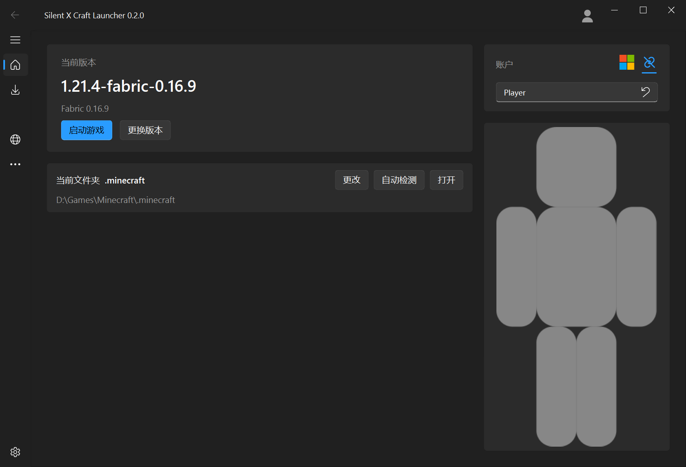
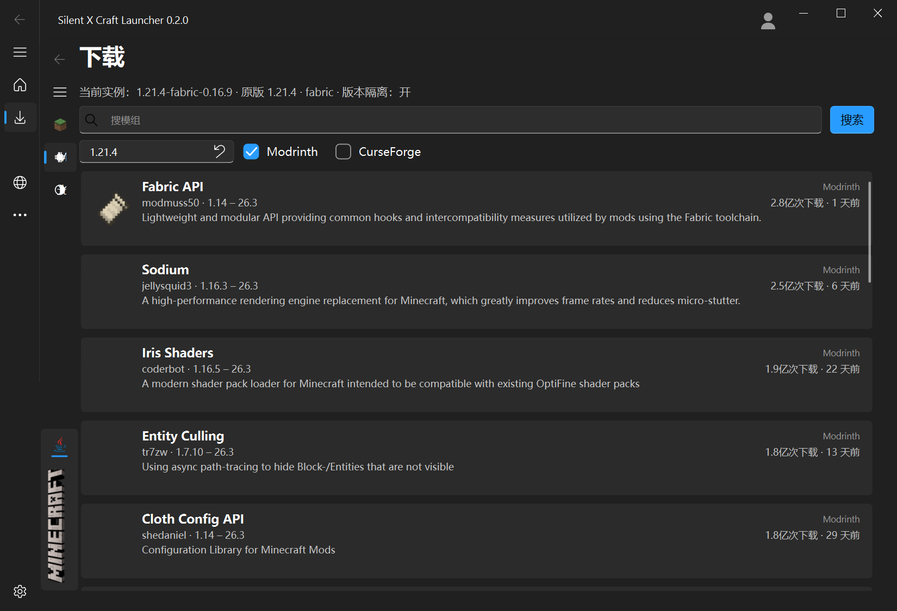

# Silent X Craft Launcher

SXCL 是一个第三方的 **Minecraft: Java Edition 启动器**,主要面向 Windows,代码同时面向 macOS、Linux 与 Android。

界面是 Fluent 风格的单窗口应用:左侧导航、右侧内容,窗口可以缩到 900×600 就不再缩小;所有文字都有自己该占的位置,放不下就换行,不会被压扁或裁掉。



## 功能

**版本**
- 浏览与下载全部正式版 / 快照 / 远古版,按版本号从新到旧排列
- 加载器静默安装:Forge / NeoForge / Fabric / Quilt / OptiFine
- 已安装版本自动扫描;**残缺版本单独列出并写明缺什么**,点一下就补全(版本文件 / 客户端 jar / 依赖库)
- 每个版本一张"游戏配置"说明:原版还是 Forge + OptiFine 之类,只写人话

**启动**
- Java 自动探测(注册表、常见安装目录、官方运行时)与按版本下发运行时
- 参数拼装、版本隔离、启动日志、崩溃报告与卡死取证(看门狗会在界面卡住时落一份现场)

**模组与光影**
- 双源:Modrinth 与 CurseForge,两个都能勾、也都能取消,结果合并成一份列表
- 中文名(随包一张表,查不到就显示原名,不机器翻译)
- 版本范围、开发商、下载量(万/亿)、更新时间、来源标记
- 点一行进详情页看完整介绍,详情页里一个「安装」按当前实例的版本与加载器装最合适的文件

  

**账户**
- Microsoft 账号设备码登录(浏览器输 8 位码,窗口自己等)、离线登录
- 登录后拉皮肤头像,顶栏显示头像与玩家名

**网络**
- 连接复用、HTTP/2、查询与图标两级缓存、失败快速回退
- 第二次进同一页面,图标 0 请求

## 构建

依赖:CMake ≥ 3.24、MSVC(VS 2022 及以上)、Qt 6.11(Widgets / Network / Svg)。

```powershell
cmake -S . -B build-ui -G "Visual Studio 18 2026" -A x64 `
      -DCMAKE_PREFIX_PATH=D:/Qt/6.11.2/msvc2022_64 `
      -DSXCL_BUILD_UI=ON -DSXCL_BUILD_TESTS=ON
cmake --build build-ui --config Release
ctest --test-dir build-ui -C Release
```

纯核心库(命令行)构建可以 `-DSXCL_BUILD_UI=OFF`。产物在 `build-ui/src/ui/Release/`,
旁边会由 `windeployqt` 铺好运行时;整目录压成 zip 就是便携版。

## 目录

```
include/sxcl/    公共 C 头(对外契约)
src/core/        下载引擎、限速、校验、设置、缓存、日志与崩溃取证
src/services/    版本清单、加载器安装、模组与光影、账户、实例管理
src/ui/          Qt 界面(控件层用 libqf)
src/net/         Qt 传输后端
tools/           验收脚本与命令行工具
tests/           单元与集成测试(ctest)
docs/            设计与验收文档
patches/         第三方控件库的补丁存档
```

分层:**core ← services ← ui**,core 不反向依赖界面;跨层只走 C ABI 或稳定头文件。

## 质量

- `ctest` 覆盖核心 49 个用例、界面 55 个用例(下载、校验、版本清单、安装、启动参数、账户、界面几何)
- `tools/` 下有 20 多个验收脚本,能自己跑出数字:窗口几何、像素级比对、控件是否被裁、界面是否卡顿、
  崩溃与否、下载路径落点
- 出问题有现场:崩溃落 `.txt` + minidump,界面卡住超过阈值落一份"卡在哪"的报告

## 许可

[AGPL-3.0](LICENSE)。

## 链接

- 官网:<https://mc.silentstudio.cn>
- 仓库:<https://github.com/Silent-Studio-CN/Silent-X-Craft-Launcher>
